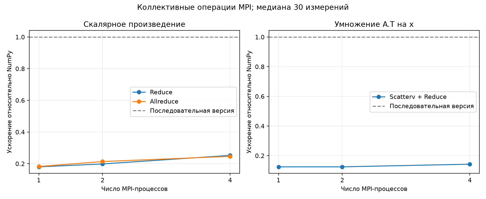

# Лабораторная работа №2

## Коллективные операции MPI. Скалярное произведение и умножение транспонированной матрицы на вектор

Исмаилов Самир Рамазан Оглы ПИН-м-о-26-1

## 1. Цель работы

Закрепить работу с коллективными операциями MPI: распределить данные между процессами, вычислить локальные результаты и объединить их через `Reduce` и `Allreduce`.

Реализованы две задачи:

1. Скалярное произведение вектора на себя: `s = a @ a`.
2. Умножение транспонированной матрицы на вектор: `b = A.T @ x`.

Использованы Python, NumPy и mpi4py. Последовательная проверка обеих задач выполняется через `np.dot`.

## 2. Скалярное произведение

Для вектора `a` длины `M` вычисляется:

$$s = \sum_{i=0}^{M-1} a_i^2.$$

Процесс 0 создаёт `a = np.arange(1, M + 1, dtype=np.float64)`. Длина передаётся через `Bcast`, затем вектор делится на непрерывные блоки с помощью `Scatterv`. Каждый процесс вычисляет `np.dot(local_a, local_a)`.

В программе предусмотрены два варианта объединения частичных сумм:

| Операция | Действие | Кто получает итог |
|---|---|---|
| `Reduce(..., op=MPI.SUM, root=0)` | Сложение локальных скалярных произведений | Только процесс 0 |
| `Allreduce(..., op=MPI.SUM)` | То же сложение с выдачей результата всем | Каждый процесс |

Например, для `a = [1, 2, 3]` и двух процессов:

```text
Ранг 0: [1, 2] → 1² + 2² = 5
Ранг 1: [3]    → 3²      = 9

Общий результат: 5 + 9 = 14.
```

Процесс 0 сравнивает полученное значение с `np.dot(a, a)`. В режиме `Allreduce` каждый процесс дополнительно выводит свой итог. Файл результата — `Results_dot_reduce.dat` или `Results_dot_allreduce.dat`.

## 3. Умножение транспонированной матрицы на вектор

Исходная матрица `A` имеет размер `M × N`, а вектор `x` — длину `M`. После транспонирования размер матрицы равен `N × M`, поэтому итоговый вектор имеет длину `N`:

$$b_j = \sum_{i=0}^{M-1} A_{ij} x_i, \qquad j=0,\ldots,N-1.$$

Матрица делится по строкам. Каждому процессу передаётся блок `local_A` размера `local_M × N` и соответствующий блок `local_x` длины `local_M`. Для обеих передач используется `Scatterv`.

Каждый процесс вычисляет `local_b = np.dot(local_A.T, local_x)`. Размер `local_b` у всех процессов одинаковый — `N`. Затем выполняется `Reduce` с `MPI.SUM`, который поэлементно складывает эти векторы на процессе 0.

Пример:

```text
A = [[1, 2],    x = [1, 2, 3]
     [3, 4],
     [5, 6]]

Ранг 0 получает первые две строки A и x = [1, 2]:
local_b = [1·1 + 3·2, 2·1 + 4·2] = [7, 10].

Ранг 1 получает последнюю строку A и x = [3]:
local_b = [5·3, 6·3] = [15, 18].

Reduce с MPI.SUM: [7, 10] + [15, 18] = [22, 28].
```

Результат проверяется через `np.dot(A.T, x)` и сохраняется в `Results_transpose.dat`.

### Почему здесь нужен Reduce, а не Gatherv

В первой лабораторной каждый процесс вычислял отдельные готовые элементы результата. Их можно было последовательно собрать через `Gatherv`.

В этой задаче каждый процесс вычисляет **частичный вклад во все N элементов**. Эти вклады нужно сложить. `Gatherv` только собрал бы несколько векторов подряд, но не выполнил бы суммирование. Можно было бы собрать их и отдельно сложить на корне, однако `Reduce` сразу выполняет нужную операцию и не требует хранения всех частичных векторов на корне.

## 4. Неравномерное распределение данных

Вычисляются `q, r = divmod(M, p)`, где `p` — число процессов. Первые `r` процессов получают по `q + 1` элементу или строке, остальные — по `q`.

Массив `counts` задаёт размеры блоков, `offsets` — начальные индексы. Это те же массивы, которые в задании названы `rcounts` и `displs`.

Для `M=7`, `N=5`, `p=4`:

| Ранг | Строки A и элементы x | counts | offsets | Число элементов A |
|---:|---|---:|---:|---:|
| 0 | 0–1 | 2 | 0 | 10 |
| 1 | 2–3 | 2 | 2 | 10 |
| 2 | 4–5 | 2 | 4 | 10 |
| 3 | 6 | 1 | 6 | 5 |

При передаче матрицы размеры и смещения умножаются на `N`, при передаче вектора используются без умножения. Для скалярного произведения вектор делится по той же схеме.

Если процессов больше, чем строк или элементов, часть процессов получает пустые блоки. Локальное скалярное произведение тогда равно нулю, а вклад в `A.T @ x` — нулевой вектор длины `N`. Эти процессы продолжают участвовать в коллективных операциях.

## 5. Файлы и команды запуска

| Файл | Назначение |
|---|---|
| `src/dot_product.py` | Скалярное произведение, варианты Reduce и Allreduce |
| `src/transpose_matvec.py` | Умножение A.T на x |
| `src/common.py` | Разбиение, проверка размеров, чтение данных |
| `scripts/generate_data.py` | Создание матрицы и вектора |
| `scripts/benchmark.py` | Замеры, таблица и график |
| `tests/` | Проверки функций и MPI-программ |

В `data/in.dat` сначала записано число столбцов `N`, затем число строк `M`, как в первой лабораторной. Матрица читается из `AData.dat`, вектор длины `M` — из `xData.dat`. Основной набор имеет размер `1000 × 500`, дополнительный набор `data/uneven` — `7 × 5`. Числа сохраняются в текстовом виде с точностью для `float64`.

Из корня проекта, при установленном MPI:

```bash
python -m pip install -r requirements.txt
mpiexec -n 4 python src/dot_product.py --size 1000000 --mode reduce
mpiexec -n 4 python src/dot_product.py --size 1000000 --mode allreduce
mpiexec -n 4 python src/transpose_matvec.py
mpiexec -n 4 python src/transpose_matvec.py --data-dir data/uneven
```

Генерация нового набора без изменения основных данных:

```bash
python scripts/generate_data.py --rows 7 --cols 5 --output data/custom
mpiexec -n 4 python src/transpose_matvec.py --data-dir data/custom
```

## 6. Проверка корректности и точности

Выполнены **14 автоматизированных тестов**. Они проверяют разбиение, чтение входа, командный запуск и вычисления в настоящих MPI-процессах. Внутри MPI-тестов проверяется несколько размеров для каждого числа процессов.

| Проверка | Условия | Результат |
|---|---|---|
| Разбиение | M=0,1,2,7,8; в том числе M меньше p | Пройдено |
| Обе задачи и оба вида редукции | p=1,2,4,8; размеры 1×1, 2×3, 7×5, 8×4, 31×17 | Совпадение с NumPy в пределах допуска |
| Ручные примеры | Скалярное произведение 14; A.T @ x = [22,28] | Совпадение |
| Allreduce | Проверка результата на каждом ранге | Пройдено |
| Некорректные данные | Пустой вектор, неверные размеры, неизвестный режим | Все ранги получают ошибку |
| Отсутствующие файлы | Запуск на четырёх процессах | Завершение с ошибкой без зависания |

Сравнение выполняется с `rtol=1e-12` и `atol=1e-12`. Побитовое совпадение не требуется: редукция меняет порядок сложения вещественных чисел.

В эксперименте получены следующие максимальные отклонения от последовательного NumPy:

| Задача | p | Максимальная абсолютная ошибка | Относительная ошибка |
|---|---:|---:|---:|
| Скалярное произведение, оба варианта | 2 | 33 472 | 1,0042·10⁻¹³ |
| Скалярное произведение, оба варианта | 4 | 96 448 | 2,8934·10⁻¹³ |
| A.T @ x | 2 | 4,2633·10⁻¹³ | 4,0158·10⁻¹⁶ |
| A.T @ x | 4 | 3,1264·10⁻¹³ | 3,8049·10⁻¹⁶ |

Для вектора `a=[1,…,1000000]` сумма квадратов имеет порядок `3,33·10¹⁷`, поэтому абсолютное отличие в десятки тысяч соответствует очень малой относительной ошибке. Тип `float64` не может точно представить все целые числа такого порядка. Сравнение с NumPy показывает согласованность реализаций, а не точное совпадение с математической суммой. Для векторного результата абсолютная ошибка — максимум по компонентам, относительная — отношение евклидовых норм ошибки и эталона. При одном процессе в этих измерениях отклонения от NumPy равны нулю.

Проверки форматирования Black, стиля flake8 и типов mypy также пройдены. Проверки преподавателя не запускались.

## 7. Производительность

Эксперимент выполнен на одном компьютере: Windows 11, Python 3.12.14, NumPy 2.3.5, mpi4py 4.1.2, Intel MPI 2021.18.1. Доступно 12 логических процессоров. Для локального запуска использована Windows-реализация MPI; код использует стандартные операции mpi4py и может запускаться с Open MPI или MPICH в соответствующем окружении.

Для скалярного произведения использован вектор длины `1000000`, для второй задачи — матрица `1000 × 500` и вектор длины `1000`, генератор `np.random.default_rng(42)`. Параметры потоков `OMP_NUM_THREADS`, `OPENBLAS_NUM_THREADS`, `MKL_NUM_THREADS` установлены в `1`.

Для каждой задачи выполнено 5 прогревочных и 30 измеряемых запусков. В таблицах приведена медиана. В последовательной версии измеряются проверка входного массива и `np.dot`. Для MPI измеряется полный вызов функции: проверка входа на корне, рассылка служебных данных, выделение буферов, Scatterv, локальное вычисление и Reduce/Allreduce. Чтение файлов, создание исходных данных, запуск Python/MPI и сравнение результатов в интервал не входят.

Перед MPI-замером вызывается `Barrier`, время измеряется через `MPI.Wtime`, затем выбирается максимальная продолжительность среди рангов. Последовательные замеры используют `time.perf_counter`.

Ускорение: `S(p) = T_seq / T_parallel(p)`. Для всех p используется фиксированная база из запуска с одним процессом. Для Reduce и Allreduce скалярного произведения база одна и та же. В обеих реализациях локальное умножение выполняет NumPy.

### 7.1. Скалярное произведение

Последовательное время: **0,506350 мс**.

| Процессы | Reduce, мс | Allreduce, мс | S Reduce | S Allreduce |
|---:|---:|---:|---:|---:|
| 1 | 2,813150 | 2,778950 | 0,1800 | 0,1822 |
| 2 | 2,553200 | 2,370050 | 0,1983 | 0,2136 |
| 4 | 2,007200 | 2,056000 | 0,2523 | 0,2463 |

### 7.2. Умножение транспонированной матрицы

Последовательное время: **0,146100 мс**.

| Процессы | Scatterv + Reduce, мс | Ускорение |
|---:|---:|---:|
| 1 | 1,171950 | 0,1247 |
| 2 | 1,171400 | 0,1247 |
| 4 | 1,025100 | 0,1425 |



Пунктир соответствует последовательной версии: `S=1`. Все MPI-результаты ниже этой линии, то есть в данном эксперименте MPI медленнее последовательного NumPy. Даже при p=1 у MPI-версии есть дополнительные расходы: выделение буферов, копирование и коллективные вызовы.

При переходе от одного MPI-процесса к четырём время уменьшается, но расходы распределения данных остаются значительными. В обеих задачах выполняется мало арифметических операций на один передаваемый элемент. Проверка всей матрицы или вектора на корне также является последовательной частью измеряемой функции. Поэтому уменьшение локальных блоков не даёт идеального ускорения.

Allreduce выдаёт результат всем процессам и в общем случае требует другой коммуникационной схемы, чем Reduce. Однако по этим замерам нельзя утверждать, что он всегда медленнее: при p=2 он оказался немного быстрее, а при p=4 — немного медленнее. На результат влияют реализация MPI и текущая нагрузка компьютера.

Исходные данные: [таблица CSV](report/performance.csv), [все времена и параметры среды](report/raw_timings.json). Выводы относятся к одному компьютеру и указанным размерам; предел масштабируемости на кластере этим экспериментом не определён.

Для повторения:

```bash
python -m pip install -r requirements-dev.txt
python -m pytest -q
python scripts/benchmark.py
```

Повторный эксперимент обновит таблицу и график. Числа в тексте отчёта после этого необходимо сверить с новыми результатами.

## 8. Выводы

Реализованы обе задачи и два варианта редукции скалярного произведения. Программы поддерживают неравномерное разбиение и процессы с пустыми блоками. Численные результаты согласуются с последовательным NumPy в пределах заданной погрешности.

Reduce нужен, когда итог достаточно получить на одном процессе, Allreduce — когда он нужен каждому. Для `A.T @ x` требуется суммирование частичных вкладов через `MPI.SUM`, поскольку каждый процесс вычисляет вклад во весь результирующий вектор.

На выбранных размерах расходы MPI превысили выигрыш от распараллеливания. Возможные улучшения — сохранять распределённые данные между повторными вычислениями, переиспользовать буферы и выполнять последовательную проверку входа до измеряемого вычислительного цикла. Эти изменения в данном эксперименте не проверялись.
